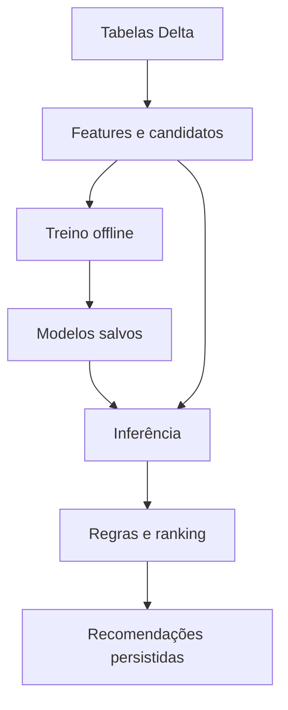

# FRUKI — IA e Databricks

## Sumário

- [Arquitetura de IA no Databricks](#arquitetura-de-ia-no-databricks)
- [Treinamento e engenharia de features](#treinamento-e-engenharia-de-features)
- [Modelos, inferência e saídas](#modelos-inferência-e-saídas)
- [Explicabilidade e decisão comercial](#explicabilidade-e-decisão-comercial)
- [Critérios e métodos de avaliação](#critérios-e-métodos-de-avaliação)
- [Falsos positivos, evidências e aceite](#falsos-positivos-evidências-e-aceite)
- [Operação e reprodutibilidade no Databricks](#operação-e-reprodutibilidade-no-databricks)

# Arquitetura de IA no Databricks

A solução estima propensão de compra, necessidade de reposição e potencial de adoção de novos SKUs. Utiliza modelos supervisionados de árvores e uma camada determinística de decisão comercial. A infraestrutura informada é Databricks Free Edition com compute serverless. O processamento usa notebooks, com bases e resultados persistidos em tabelas Delta no Unity Catalog.

## Componentes e responsabilidades

| Componente | Responsabilidade |
|---|---|
| Bases Delta | Cadastros, histórico de compras, visitas, contagens, sell-out e contexto. |
| Notebooks 02–04 | Feature engineering, geração de candidatos, treinamento, avaliação e inferência. |
| `modelos_treinados` | Pacotes de estimadores serializados para reutilização. |
| Notebook 05 | Consolidação, regras de prioridade, listas e projeção de meta. |
| Job Databricks | Orquestração do reprocessamento e atualização das saídas. |

## Pipeline de dados

Os cadastros de produtos e preços são associados a clientes, compras e contagens. Datas, IDs e valores são normalizados; características de perfil, produto e contexto são agregadas por cliente e SKU. O comportamento transacional é descrito como sintético, produzido por um gerador citado nos materiais, mas não recebido.

As features são calculadas para uma referência temporal, `data_ref`. O histórico de compra usado nessas features deve ser anterior à referência. O gerador de candidatos restringe os produtos elegíveis antes de aplicar os modelos. Os scores recebem pós-processamento de quantidade, elegibilidade e ranking, e as saídas são gravadas para consulta.

Spark faz a leitura/gravação das tabelas; o treinamento scikit-learn executa com pandas no processo Python, não como modelo Spark ML distribuído. Os notebooks carregam tabelas com `toPandas()`. O recorte de saída por cliente não elimina todas as leituras completas. O notebook 05 reconstrói listas globalmente; as gravações não publicam todas as tabelas em uma única transação. A referência de cada saída deve ser verificada para evitar mistura de estados de processamento.

# Treinamento e engenharia de features

## Algoritmo e aprendizado

Os estimadores são `HistGradientBoostingClassifier` e `HistGradientBoostingRegressor`, do scikit-learn. O treinamento constrói exemplos históricos por cliente, SKU e instante ou contagem. As **features** representam características observáveis nessa decisão; os **targets** descrevem compras, recompras, consumo ou prazo posteriores.

O gradient boosting combina árvores sucessivas para reduzir o erro preditivo. A implementação por histogramas é adequada a dados tabulares com relações não lineares, valores ausentes e variáveis categóricas. Os códigos marcam explicitamente as colunas categóricas, em vez de tratar todos os códigos como grandezas numéricas. Não há LLM nem geração de justificativas por modelo de linguagem.

| Grupo de features | Aplicação |
|---|---|
| Histórico do cliente e SKU | Recência, frequência, quantidade típica, cadência e composição do mix. |
| Estoque e consumo | Contagem, consumo derivado, idade do registro e cobertura estimada. |
| Perfil e afinidade | Segmento, região, família, marca e participação no histórico. |
| Clientes semelhantes | Compra por região/segmento e subsegmento, sobretudo na expansão. |
| Sazonalidade e sell-out | Memória anual e vendas compartilhadas, conforme o modelo; sell-out explícito no 03. |
| Contexto | Temperatura, calendário, eventos, promoção e lançamento, conforme o modelo. |

## Amostragem e configuração

No 02, são amostrados 400 clientes por data de treino e 500 para avaliação. Mantém 20% dos negativos no ajuste e corrige sua contribuição com pesos. No 04, são 1.500 clientes por data de treino, 3.000 no teste e retenção de 12% dos negativos, também ponderada. O 03 limita amostras a 250 mil linhas de treino e 100 mil de teste. A semente é fixa em 42.

Os classificadores de compra e os regressores de consumo/prazo usam até 250 iterações e taxa de aprendizado de 0,08. A quantidade usa até 200 iterações. Os classificadores de expansão usam até 200 iterações, taxa 0,06 e árvores menores. O early stopping pode encerrar antes do limite; não há busca sistemática de hiperparâmetros registrada.

O modelo de quantidade aprende com compras positivas; quantidade e consumo utilizam transformação logarítmica do target, com inversão na inferência. Isso reduz a influência de escalas muito assimétricas, mas não elimina erro ou viés na unidade de negócio.

## Artefatos

Os pacotes finais são `itens_provaveis`, `reposicao` e `expansao`, contendo sete estimadores ao todo. São armazenados por pickle, zlib e base64 em `modelos_treinados`. O salvamento substitui o pacote pelo nome; não há versionamento imutável de modelos. A reprodução exige ambiente compatível, esquema de features e dados equivalentes.

# Modelos, inferência e saídas

## Itens prováveis — notebook 02

Estima a chance de compra do SKU em qualquer pedido nos próximos **14 dias**. Considera clientes ativos nos 90 dias anteriores e combina candidatos do histórico, da popularidade do segmento/região, da memória sazonal e das promoções em famílias relevantes.

Um classificador estima propensão e um regressor prevê quantidade condicional à compra. Os dez maiores scores são publicados em `recomendacao_itens`, com probabilidade, quantidade, posição e motivo. A agregação dos candidatos também gera `previsao_volume_cliente`. A cobertura do gerador de candidatos limita o recall: produto excluído nessa etapa não pode ser recuperado pelo ranking.

## Reposição — notebook 03

Dois regressores estimam consumo diário do próximo intervalo e prazo até o próximo pedido do SKU. O consumo de treinamento é derivado das diferenças entre contagens e dos pedidos associados, sem medição direta de demanda. A função atual considera o pedido do dia da contagem anterior; compras intermediárias sem contagem podem ficar de fora.

O pós-processamento projeta estoque e cobertura, define risco de ruptura e sugere quantidade. Exige contagem recente na janela de 35 dias. O prazo de entrega da regra é quatro dias; a ação pode ser urgente, antecipada, na próxima visita ou sem ação por baixo giro. A urgência depende principalmente da cobertura e do lead time; a previsão do segundo regressor é um diagnóstico complementar.

A saída `recomendacao_reposicao` conserva consumo previsto, estoque estimado, cobertura, prazo, quantidade e ação. Sem contagem elegível, podem permanecer resultados anteriores, que não devem ser apresentados como nova confirmação de estoque.

## Expansão e acompanhamento — notebook 04

Seleciona SKUs disponíveis e nunca comprados pelo cliente, a partir de compras entre estabelecimentos semelhantes. Dois classificadores estimam experimentação em **28 dias** e adoção condicionada à experimentação. Adoção significa primeira compra seguida de pelo menos duas recompras em **120 dias**. As estimativas são combinadas para ordenar até cinco novidades.

O log controla reoferta após 180 dias, condicionada a sinal mínimo de compra entre pares. Um terceiro classificador acompanha primeiras compras recentes usando a primeira recontagem, giro e sell-through estimado. O campo legado `prob_recompra` representa o target de adoção usado no ajuste, e não apenas a chance de uma recompra.

## Reprocessamento

Em `modo=recomendar`, os pacotes salvos são reaplicados às features atualizadas. Novas compras podem alterar scores e elegibilidade sem mudar os parâmetros aprendidos. Se o pacote falhar ao carregar, o código atual retorna a `treinar`; o log deve confirmar o modo efetivamente executado.

# Explicabilidade e decisão comercial

## Como rastrear uma indicação

A leitura de uma recomendação deve separar quatro elementos: **dados observados**, **estimativa aprendida**, **regra comercial** e **resultado publicado**. Isso permite explicar a lógica sem atribuir ao modelo decisões que foram definidas manualmente.

| Resultado | Evidência e interpretação |
|---|---|
| Compra provável | Frequência, recência e demais features alimentam a estimativa de compra em 14 dias. |
| Reposição urgente | Consumo previsto e estoque estimado determinam cobertura; a regra compara essa cobertura ao prazo de entrega. |
| Novo SKU | Afinidade e compra entre pares alimentam experimentação e adoção; elegibilidade e log podem excluir o item. |
| Prioridade do vendedor | O notebook 05 normaliza scores por tipo e aplica pesos comerciais e urgência da meta. |

**Exemplo didático:** com estoque estimado de 20 unidades e consumo previsto de cinco por dia, a cobertura é de quatro dias. Como o prazo de entrega considerado também é quatro dias, a regra indica urgência. O consumo é estimado pelo modelo; cobertura e classificação de urgência são pós-processamento rastreável. Os números ilustram a lógica e não representam uma previsão medida.

## Justificativas implementadas

Os campos `motivo` e `motivo_cliente` são templates ativados por condições como recorrência, estoque baixo, promoção, memória sazonal, família já comprada e prevalência entre clientes semelhantes. Nos modelos 02/04, aparecem os primeiros motivos elegíveis em ordem programada, e não uma ordenação aprendida por importância.

Esses textos **não decompõem a contribuição de cada variável**. Não é possível afirmar que a promoção aumentou o score em determinada quantidade de pontos. SHAP e explicações locais equivalentes não estão implementados. A explicabilidade atual está nos dados, transformações, regras e semântica dos scores, sem atribuição completa do ensemble por previsão.

## Ranking e limites de leitura

O 05 converte scores brutos em percentis por tipo e aplica pesos: reposição 1,0; itens prováveis 0,7; novo SKU 0,8; acompanhamento 0,9. Ações de volume recebem reforço pela distância da meta. Até 20 ações são escolhidas por vendedor, com reserva de 30% para novidades/acompanhamento quando existirem candidatos.

O score comercial pode superar 1 e não deve ser apresentado como probabilidade. A seleção por top K não possui limiar mínimo de confiança: um score baixo ainda pode aparecer entre os melhores candidatos. Compra entre pares não comprova sell-out, e propensão de adoção não comprova efeito causal da recomendação.

Para auditoria individual mais forte, recomenda-se conservar valores das features, data de disponibilidade das fontes, artefato utilizado, score antes do arredondamento e regras disparadas. Esse registro completo ainda não é persistido por previsão.

# Critérios e métodos de avaliação

## Testes implementados por modelo

| Modelo | Desenho de avaliação no código |
|---|---|
| 02 — Compra | Treino, validação e teste temporais; baselines de última compra, frequência e popularidade; ablação A/B/C; permutação de grupos; bootstrap por cliente e análise de calibração. |
| 03 — Reposição | Treino/teste temporais; ablação por alvo; comparação com consumo recente, média histórica e cadência; uso de `gabarito_consumo` na avaliação de consumo. |
| 04 — Expansão | Treino/teste com horizonte de acompanhamento; baselines de popularidade, afinidade e aleatório; bootstrap por cliente, permutação dos sinais de pares e AUC. |

No 02, A utiliza histórico, perfil e produto; B acrescenta estoque; C acrescenta sazonalidade e contexto. No consumo do 03, B acrescenta sell-out e memória anual, e C acrescenta contexto. O experimento de prazo possui composição própria. Não há ablação A/B/C no 04, e ele deriva os rótulos do histórico de compras, sem ler `gabarito_adocao`. Bootstrap e placebo não estão implementados no 03 recebido.

## O que cada métrica verifica

| Métrica | Critério avaliado |
|---|---|
| Precision@10 | Quantas indicações do top 10 foram compradas na janela; mede confirmação das recomendações. |
| Recall@10 | Quanto das compras posteriores foi recuperado no top 10. |
| HitRate@10 | Casos cliente-data com pelo menos uma compra corretamente indicada. |
| NDCG@10 | Qualidade da ordem; acertos nas primeiras posições têm maior relevância. |
| Erro relativo mediano | Desvio proporcional da previsão de quantidade/consumo; no consumo há piso no denominador. |
| MAE e tolerância de sete dias | Erro do prazo previsto até o pedido e frequência de acerto nessa tolerância. |
| Adotou@5 e lift | Adoções no top 5 e desempenho relativo à taxa-base entre candidatos. |
| AUC e calibração | AUC avalia discriminação; calibração compara scores com frequências observadas. |

Baselines verificam se a complexidade do modelo agrega em relação a regras simples. Ablação compara conjuntos de features. A permutação verifica dependência preditiva de grupos de informação; o desempenho não precisa cair ao aleatório, porque outros sinais permanecem. Os ICs usam 400 reamostragens por cliente para diferenças específicas, não para gerar confiança individual de cada sugestão. Um intervalo que inclui zero não sustenta uma conclusão de ganho positivo na diferença avaliada.

A avaliação de ranking do 02 exclui casos sem compra futura no resumo principal; o recall de adoção do 04 é condicionado aos candidatos. Reportar também cobertura de clientes e candidatos evita interpretar esses resultados como desempenho sobre toda a carteira.

# Falsos positivos, evidências e aceite

## Como interpretar uma indicação não confirmada

No modelo de compra, uma recomendação não confirmada é um produto indicado que não foi comprado nos 14 dias seguintes. Na expansão, o acompanhamento precisa respeitar a janela de primeira compra e as duas recompras exigidas. Na reposição, uma entrega pode evitar a falta prevista: ausência de ruptura após intervenção não prova, isoladamente, que o alerta era falso.

O output preservado do 02 registra **14.521 acertos em 28.120 sugestões**, aproximadamente **51,6% de confirmação**. As 13.599 restantes não se confirmaram naquela janela. A proporção não confirmada não é a FPR técnica, que depende de todos os casos realmente negativos. Também não equivale a erro de 48,4% em toda a base ou a perda comercial.

Os notebooks recebidos preservam resultados de recomendação, sem as tabelas completas de avaliação do treino. Portanto, não há evidência suficiente para declarar uma taxa baixa de falsos positivos ou superioridade estatística dos modelos nesta documentação. A validação completa depende de reexecução com dados e artefatos disponíveis.

## Critérios recomendados para homologação

| Critério | Evidência exigida para aprovação |
|---|---|
| Integridade temporal | Features e rótulos disponíveis no corte correto; teste final intocado. |
| Ganho sobre baseline | Comparação pareada em período comum; ganho relevante e incerteza documentada. |
| Controle de falsos positivos | Precision@K e erros por segmento, com limite mínimo definido pelo negócio. |
| Probabilidades utilizáveis | Calibração por faixa de score e tratamento explícito de baixa confiança. |
| Cobertura | Clientes elegíveis atendidos e compras perdidas no gerador de candidatos. |
| Reposição confiável | Erros de consumo/prazo, idade da contagem e análise de casos de ruptura. |
| Rastreabilidade | Insumos, referência, modelo e regras recuperáveis para uma indicação. |

Esses critérios são uma proposta de aceite, não resultados já atingidos. Não foi definido limiar universal de precisão ou score: ele deve refletir o custo comercial de oferta indevida e de oportunidade perdida. Um limiar de abstenção por baixa confiança ainda não existe no código.

## Ajustes que condicionam a validade dos testes

O fator de volume do 02 é aprendido no teste e deve migrar para validação. O 03 calcula próxima visita com registros sem corte na referência. O acompanhamento do 04 pode usar recontagem futura. Preços, logs e quantidades típicas também exigem recorte temporal consistente. Para prazo de até 90 dias, a separação do 03 precisa garantir que o desfecho do treino já fosse conhecido no corte.

O clima realizado é usado como previsão perfeita, e os dados são sintéticos. Corrigir esses pontos e repetir a avaliação é necessário antes de afirmar ausência de vazamento temporal ou generalização para clientes reais.

# Operação e reprodutibilidade no Databricks

## Ordem de execução

Disponibilizar as tabelas-base e suas permissões no catálogo/esquema esperado. Os cadastros CSV não substituem o histórico transacional. Para reconstruir o dataset, é necessário o gerador 01 ou uma carga equivalente; o gerador não foi enviado.

Executar 02, 03 e 04 com `modo=treinar`, conferir métricas e confirmar os três pacotes salvos. Executar o 05 para produzir as listas consolidadas. Configurar o job com dependências 02 → 03 → 04 → 05. Na operação recorrente, usar os modelos existentes em `modo=recomendar` e validar o estado final de todas as etapas antes de considerar o resultado atualizado.

| Parâmetro | Uso |
|---|---|
| `modo` | `treinar` ajusta estimadores; `recomendar` aplica pacotes existentes. |
| `clientes` | Todos, um ID ou lista de IDs. |
| `data_ref` | Origem temporal explícita; `ultima` usa o fim do histórico menos 14 dias. |
| `usar_log` no 04 | `sim` aplica reoferta e grava log; `nao` ignora a espera e não grava. |

## Controles de entrada e saída

Antes do treino, verificar chaves, duplicatas, referências de cliente/produto, datas, unidade de quantidade e intervalos de contagem. Na inferência, conferir atividade do cliente, candidatos disponíveis, cobertura temporal do contexto e idade do estoque. Dados insuficientes devem ser distinguidos de uma previsão negativa; não há fallback universal para cliente sem histórico recente.

As saídas principais são `recomendacao_itens`, `recomendacao_reposicao`, `recomendacao_expansao`, `acompanhamento_novos_skus`, `previsao_volume_cliente`, `lista_vendedor`, `lista_cliente` e `resumo_vendedor`. Conferir `data_referencia` em todo o lote, não apenas na primeira linha. A atualização parcial do catálogo de recompra precisa ser corrigida para não reapender registros de clientes fora do escopo.

## Reprodutibilidade e acompanhamento

Fixar versões de Python, pandas, NumPy e scikit-learn compatíveis com o artefato. Carregar pickle somente de origem confiável. Preservar conjunto ordenado de features, parâmetros efetivos, corte dos dados, rótulos completos, população avaliada e resultados dos baselines. O campo `treinado_ate` atual indica o fim do histórico carregado, não necessariamente o último desfecho usado no ajuste.

Monitorar cobertura, distribuição dos scores, ausência de features, idade das contagens, divergência de referências, duração/falha dos jobs e qualidade quando os rótulos amadurecerem. Registro imutável de modelos, monitoramento de drift e snapshot completo das features por previsão são evoluções recomendadas, ainda não implementadas.

A base técnica desta documentação são os notebooks 02–05 e os outputs fornecidos. O código foi inspecionado, mas o treino e os jobs não foram reexecutados no workspace remoto. Assim, a documentação distingue funcionamento implementado, evidência preservada e critérios de validação ainda a cumprir.
